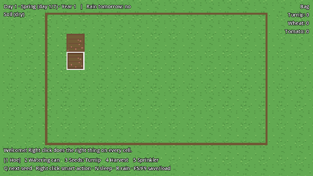

<div align="center">

# Farming Kit for Godot 4

**A free, ready-to-use farming system for Godot 4.**
Till, water, plant, grow through seasons, harvest. Drop it into any 2D game.




[English](#english) · [Bahasa Indonesia](#bahasa-indonesia)

</div>

---

## English

Most farming systems you can buy are made for Unreal, Unity, or RPG Maker. Farming Kit gives Godot developers the same core loop for free: a small set of nodes and resources that handle the rules, while you keep full control over art, tools, inventory, and UI.

### Features

- **Till, water, plant, harvest** on a grid, with clear reasons when an action fails
- **Growth stages** driven by days, from seed to ripe, with any number of sprites
- **Seasons**: crops only grow in their seasons and wither when the season changes
- **Regrowing crops** (tomatoes, berries) that stay after harvest
- **Random yields** and **rare harvests** with a configurable chance
- **Sprinklers** with cross, square, and 5x5 patterns, and an editor preview of their range
- **Rain** that waters every field
- **Soil that dries out** and turns back into ground after a number of days (optional)
- **Save/load** to plain dictionaries (works with JSON or ConfigFile)
- **Works with any art**: the field draws its own soil, or turn that off and paint your TileMap from the signals
- **No dependencies**, typed GDScript, and 54 automated tests
- A **playable demo** with original pixel art

### Install

1. Copy `addons/farming_kit` into your project's `addons/` folder
   (or download this repo and copy the folder).
2. **Project → Project Settings → Plugins** and enable **Farming Kit**.
   This also adds the `FarmCalendar` autoload.
3. Open `addons/farming_kit/examples/demo.tscn` and press **F6** to try it.

### Quick start

**1. Make a crop.** In the FileSystem dock: right click → **New Resource → FarmCrop**. Set an `id`, the `grow_days`, and the `stage_textures` (seed → ripe). Optionally set `seasons`, `regrow_days`, the yield range, and `rare_chance`.

**2. Add a field.** Add a **FarmField** node to your scene, set its `area` (in cells), and add your crops to `crop_library`.

**3. Connect your tools.**

```gdscript
@onready var field: FarmField = $FarmField
var turnip: FarmCrop = preload("res://crops/turnip.tres")

func use_tool(tool: String, world_pos: Vector2) -> void:
    var cell := field.world_to_cell(world_pos)
    match tool:
        "hoe": field.till(cell)
        "watering_can": field.water(cell)
        "seeds": field.plant(cell, turnip)
        "hand":
            var result := field.harvest(cell)
            if result:
                inventory.add(result.crop.id, result.amount)

func _ready() -> void:
    field.action_failed.connect(func(cell, reason):
        if reason == FarmField.Result.WRONG_SEASON:
            show_message("This crop doesn't grow in this season."))
```

**4. Start a new day** when the player sleeps:

```gdscript
FarmCalendar.next_day()            # crops that were watered grow
FarmCalendar.next_day(true)        # same, and it rains: every field is watered
```

### API overview

| Node / Resource | What it does |
|---|---|
| `FarmCrop` (Resource) | Crop data: `id`, `grow_days`, `stage_textures`, `seasons`, `regrow_days`, `yield_min/max`, `rare_chance`, `needs_water`, `withers_out_of_season`, `metadata` |
| `FarmField` (Node2D) | The farmland grid. Actions: `till`, `untill`, `water`, `water_all`, `plant`, `harvest`, `remove_crop`, `grow`, `advance_day`. Queries: `is_tilled`, `is_watered`, `has_crop`, `is_ripe`, `get_cell_info`, `get_ripe_cells`, `get_thirsty_cells`. Save: `to_dict`, `from_dict` |
| `FarmSprinkler` (Node2D) | Waters cells around it every morning. Patterns: `CROSS`, `SQUARE`, `BIG_SQUARE` |
| `FarmCalendar` (autoload) | Day, season, year. `next_day(rain)`, `season()`, `day_of_season()`, `year()`, `to_dict`, `from_dict`. Season names and length are configurable |

**FarmField signals:** `tilled`, `untilled`, `watered`, `planted`, `grew`, `ripened`, `harvested`, `withered`, `day_processed`, `action_failed(cell, result)`.

Every action also has a `can_*` version (`can_till`, `can_water`, `can_plant`, `can_harvest`) that returns a `FarmField.Result` without changing anything. Use it to show the right cursor or tooltip.

### Tips

- **Using your own TileMap for soil?** Set `draw_soil = false` and update your tiles from the `tilled`, `watered`, `untilled`, and `day_processed` signals.
- **Tropical game?** Set `FarmCalendar.season_names = ["dry", "rainy"]`.
- **Fertilizer?** Call `field.grow(cell, 1)` to add a day of growth.
- **Prices and item ids** can go in each crop's `metadata` dictionary.

### Running the tests

```bash
godot --headless --path . --script res://tests/run_tests.gd
```

---

## Bahasa Indonesia

Sistem farming siap pakai yang **gratis** untuk Godot 4. Cangkul, siram, tanam, tumbuh mengikuti musim, lalu panen. Bisa dipasang di game 2D apa pun.

Sistem farming yang dijual di luar sana kebanyakan untuk Unreal, Unity, atau RPG Maker. Farming Kit memberi developer Godot alur dasar yang sama secara gratis: beberapa node dan resource yang mengurus aturan bertani, sementara gambar, alat, inventori, dan UI tetap sepenuhnya di tangan kamu.

### Fitur

- **Cangkul, siram, tanam, panen** di grid, dengan alasan yang jelas saat aksi gagal
- **Tahap pertumbuhan** berdasarkan hari, dari benih sampai siap panen, dengan jumlah sprite bebas
- **Musim**: tanaman hanya tumbuh di musimnya dan layu saat musim berganti
- **Tanaman yang tumbuh lagi** (tomat, beri) tetap ada setelah dipanen
- **Hasil panen acak** dan **panen langka** dengan peluang yang bisa diatur
- **Sprinkler** dengan pola silang, kotak, dan 5x5, plus pratinjau jangkauan di editor
- **Hujan** yang menyiram semua lahan
- **Tanah mengering** dan kembali jadi tanah biasa setelah beberapa hari (opsional)
- **Simpan/muat** ke Dictionary biasa (bisa JSON atau ConfigFile)
- **Cocok dengan gambar apa pun**: lahan menggambar tanahnya sendiri, atau matikan dan cat TileMap kamu dari signal
- **Tanpa dependensi**, GDScript bertipe, dan 54 tes otomatis
- **Demo yang bisa dimainkan** dengan pixel art buatan sendiri

### Cara pasang

1. Salin folder `addons/farming_kit` ke folder `addons/` di proyekmu.
2. Buka **Project → Project Settings → Plugins**, lalu aktifkan **Farming Kit**.
   Autoload `FarmCalendar` akan ditambahkan otomatis.
3. Buka `addons/farming_kit/examples/demo.tscn` dan tekan **F6** untuk mencoba.

### Mulai cepat

1. **Buat tanaman**: klik kanan di FileSystem → **New Resource → FarmCrop**. Isi `id`, `grow_days`, dan `stage_textures` (benih → siap panen). Bisa juga atur `seasons`, `regrow_days`, jumlah hasil panen, dan `rare_chance`.
2. **Tambahkan lahan**: pasang node **FarmField**, atur `area` (dalam sel), dan masukkan tanamanmu ke `crop_library`.
3. **Hubungkan alat**: panggil `till`, `water`, `plant`, dan `harvest` dengan sel dari `world_to_cell(posisi)`. Contoh kodenya ada di bagian English di atas.
4. **Ganti hari** saat pemain tidur: `FarmCalendar.next_day()`, atau `FarmCalendar.next_day(true)` kalau hujan.

Saat aksi gagal, signal `action_failed(cell, result)` memberi tahu alasannya (`NOT_TILLED`, `WRONG_SEASON`, `NOT_RIPE`, dan lain-lain), jadi kamu bisa menampilkan pesan dalam bahasa apa pun.

**Tips:** untuk game bertema Indonesia, ganti musim menjadi `FarmCalendar.season_names = ["kemarau", "hujan"]`.

### Kontrol demo

| Tombol | Fungsi |
|---|---|
| `1`–`5` | Pilih alat: cangkul, penyiram, benih, panen, sprinkler |
| `Q` | Ganti jenis benih |
| Klik kiri | Pakai alat |
| Klik kanan | Aksi otomatis: cangkul → tanam → siram → panen |
| `N` / `Spasi` | Tidur (hari berikutnya) |
| `R` | Hujan besok: ya/tidak |
| `F5` / `F9` | Simpan / muat |

---

## License

[MIT](LICENSE). Free for personal and commercial games. The demo art in `addons/farming_kit/examples/sprites` is original and also MIT.

Made by [@misbah2121](https://github.com/misbah2121). The system grew out of [Modern Farm](https://github.com/misbah2121/ModernFarm), a farming game built in Godot.
